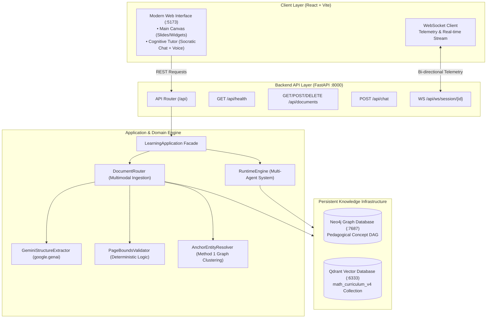

# 📘 PROJECT HANDOVER & ARCHITECTURAL BLUEPRINT
**Omni-Tutor: AI-Native Cognitive Learning Platform**

---

## 1. Executive Summary & Project Vision

**Your-Learning (Omni-Tutor)** is an advanced, AI-native personalized cognitive tutor and pedagogical knowledge companion. It transforms heterogeneous learning materials (lecture slides, academic research papers, comprehensive textbooks, and technical documents) into an interconnected **Hierarchical Pedagogical Knowledge Graph (Neo4j)** and **Dense Vector Index (Qdrant)**, enabling adaptive, multi-agent interactive learning experiences.

### Key Milestones Achieved
1. **Lean Architecture Standardized**: Removed legacy branching and empty stubs; standardized on `MultiAgentRuntime` and direct flat `application/facade.py` interfaces under strict **M-YAGNI** principles.
2. **Modern Full-Stack Transition**: Migrated from legacy Streamlit (`main_streamlit_backup.py`) to a high-performance **FastAPI Backend (`api/`)** and **React (Vite + TypeScript + Tailwind CSS) Frontend (`frontend/`)**.
3. **Multimodal Document Router & Ingestion Engine**: Eliminated brittle regex overfitting with native **Gemini Multimodal Vision** (`google.genai`), deterministic **Page Bounds Validation**, and type-specific routing (`PAPER`, `BOOK`, `SLIDE`).
4. **Anchor Entity Resolution**: Implemented vector pre-filtering and divide-and-conquer batch resolution in `database/entity_resolver.py` to prevent knowledge graph entity duplication.
5. **Zero-Regression Test Suite**: Comprehensive suite of **95 automated unit tests (100% passing)**.

---

## 2. High-Level System Architecture



---

## 3. Core Modules & Subsystems

### 3.1. Multimodal Document Router & Slicing (`database/document_router.py`)
Intelligently classifies and processes multi-format documents:
- **`PPTX`**: Extracts shapes, slide-by-slide text, and **Speaker Notes** via `python-pptx`.
- **`DOCX`**: Parses semantic `Heading 1/2/3` hierarchy via `python-docx`.
- **`PDF`**: Uses Gemini Multimodal Vision to inspect visual layout, font hierarchy, and multi-column formatting, then routes to:
  - **`SLIDE`**: Exactly 1 chunk per slide, preserving bullet points and layout integrity.
  - **`PAPER`**: Slices by Paper Title $\rightarrow$ Major Sections $\rightarrow$ Subsections.
  - **`BOOK`**: Granular deep slicing down to **Subsections** (`Chapter > Section > Subsection`).
- **Zero-Downtime Fallback**: Automatically invokes `MathAwareDocumentProcessor` if `GOOGLE_API_KEY` is unavailable or if cloud quotas are exhausted.

### 3.2. Deterministic Page Bounds Validator (`database/page_validator.py`)
Guards against LLM page hallucination via mathematical boundary checks:
1. **Hard Bounds Clamping**: $1 \le \text{start\_page} \le \text{end\_page} \le \text{total\_pages}$.
2. **Inverted Bounds Inversion**: Automatically forces $\text{end} = \text{start}$ if $\text{start} > \text{end}$.
3. **Monotonic Progression**: Enforces $\text{start}_{i+1} \ge \text{start}_i$.
4. **Parent Envelopment**: Guarantees parent chapters/sections encompass all child page intervals.
5. **Same-Page Subsection Resolution**: Marks `is_same_page=True` and cleanly partitions text when multiple sections share a physical page.

### 3.3. Anchor Entity Resolver (`database/entity_resolver.py`)
Eliminates duplicate concept nodes in the knowledge graph:
- **Step 0 Qdrant Pre-Filter**: High-similarity matches ($\ge 0.92$) auto-absorb into existing canonical aliases.
- **Directional Acronym Matching**: Prevents full names from being downgraded to short abbreviations.
- **Divide-and-Conquer Batch Clustering**: Batches entities, promotes canonical labels, remaps graph edges, and purges self-loops.

### 3.4. Pedagogical Knowledge Graph (`database/semantic_dag.py`)
Persists concepts with canonical naming, aliases, and source locators. Standardized English relationships:
- `PREREQUISITE_OF`
- `RELATES_TO`
- `PART_OF`
- `DESCRIBES`
- `VERSUS`
- `EXEMPLIFIES`
- `APPLIED_IN`

### 3.5. FastAPI Application (`api/`)
Provides modern asynchronous endpoints:
- `GET /api/health`: Real-time health status of Neo4j, Qdrant, and LLM services.
- `GET /api/documents`: Lists ingested documents and hierarchical curricula.
- `POST /api/ingest`: Accepts file uploads (multipart) or JSON base64 payloads.
- `POST /api/chat`: Socratic Q&A and learning interaction.
- `WS /api/ws/session/{session_id}`: Real-time telemetry (`PING_IDLE`, `WIDGET_CHANGE`, `VIDEO_SEEK`) and streaming responses.

---

## 4. Repository Directory Structure

```
your-learning/
├── .agents/                      # Installed agent capabilities and skills
├── api/                          # FastAPI REST & WebSocket Backend
│   ├── routes/                   # Endpoint routers (health, documents, chat, ws)
│   ├── app.py                    # FastAPI application initialization & CORS
│   └── dependencies.py           # Dependency injection container wiring
├── application/                  # Clean Architecture Application Layer
│   ├── contracts.py              # DTOs and command/query contracts
│   ├── facade.py                 # LearningApplication unified facade
│   ├── ingestion_service.py      # Document ingestion application service
│   ├── learning_service.py       # Socratic lesson orchestration service
│   └── qa_service.py             # Global and scoped QA service
├── config/                       # Configuration & Settings
│   └── settings.py               # Pydantic Settings (.env configuration)
├── core/                         # Core Interfaces, Schemas & Container
│   ├── container.py              # Dependency injection container
│   ├── data_ingestion.py         # Ingestion orchestration coordinator
│   ├── interfaces.py             # Protocol interfaces
│   └── schemas.py                # Pydantic schemas (DocumentStructure, Concept, etc.)
├── database/                     # Data Access & Processing Layer
│   ├── document_processor.py     # Local typographic & regex fallback processor
│   ├── document_router.py        # Multimodal Document Router (PPTX, DOCX, PDF)
│   ├── entity_resolver.py        # Anchor-based graph entity resolver
│   ├── gemini_extractor.py       # Gemini Multimodal Vision structured extractor
│   ├── page_validator.py         # Pure-logic deterministic page bounds validator
│   ├── semantic_dag.py           # Neo4j Knowledge Graph DAG manager
│   ├── structural_db.py          # Qdrant Vector Storage client
│   └── user_db.py                # User progress and telemetry persistence
├── frontend/                     # React Vite TypeScript Tailwind Client
│   ├── src/                      # Source components, services, and state
│   ├── package.json              # NPM dependencies & scripts
│   └── vite.config.ts            # Vite bundler configuration
├── orchestrator/                 # Multi-Agent Coordination Layer
│   ├── llm_factory.py            # ChatModel instantiation factory
│   └── llm_service.py            # LLM service wrapper
├── runtime/                      # Autonomous Agent Execution Engine
│   ├── agent_runtime.py          # MultiAgentRuntime executor
│   └── engine.py                 # RuntimeEngine wrapper
├── tests/                        # Comprehensive Test Suite
│   └── unit/                     # 95 passing unit tests
│       ├── test_api_endpoints.py
│       ├── test_document_processor_upgrade.py
│       ├── test_document_router.py
│       ├── test_entity_resolver.py
│       ├── test_page_validator.py
│       └── test_pedagogical_relations.py
├── HANDOVER.md                   # This project handover & architecture guide
├── main.py                       # Application entrypoint
├── main_streamlit_backup.py      # Preserved legacy Streamlit app backup
└── requirements.txt              # Python dependencies
```

---

## 5. Getting Started & Operations Guide

### 5.1. Prerequisites
- **Python**: 3.10+ (Tested on Python 3.13)
- **Node.js**: v18+ & npm
- **Docker** (for Neo4j and Qdrant containers):
  ```bash
  # Start Qdrant Vector Database
  docker run -d -p 6333:6333 -p 6334:6334 -v qdrant_storage:/qdrant/storage qdrant/qdrant

  # Start Neo4j Graph Database
  docker run -d -p 7474:7474 -p 7687:7687 -e NEO4J_AUTH=neo4j/ExpertMentor2026 neo4j:latest
  ```

### 5.2. Environment Setup
Create a `.env` file in the project root:
```env
# LLM Provider Configuration (gemini, groq, openai, or ollama)
LLM_PROVIDER=gemini
LLM_MODEL_NAME=gemini-2.5-flash
GOOGLE_API_KEY=your_google_ai_studio_api_key_here

# Qdrant Vector Database
QDRANT_HOST=localhost
QDRANT_PORT=6333
VECTOR_COLLECTION_NAME=math_curriculum_v4

# Neo4j Graph Database
NEO4J_URI=bolt://localhost:7687
NEO4J_USER=neo4j
NEO4J_PASSWORD=ExpertMentor2026
```

### 5.3. Running the Backend (FastAPI)
```powershell
# From the project root
python -m uvicorn api.app:app --reload --port 8000
```
Interactive API documentation: `http://localhost:8000/docs`

### 5.4. Running the Frontend (React + Vite)
```powershell
cd frontend
npm install
npm run dev
```
Client application: `http://localhost:5173`

---

## 6. Verification & Automated Testing

To run the complete test suite (95 tests):
```powershell
python -m pytest tests/unit/ -v
```
All **95 unit tests** must execute and pass with 0 errors and 0 regressions.

To verify frontend compilation:
```powershell
cd frontend
npm run build
```

---

## 7. Next Steps & Development Roadmap

1. **Live Gemini Multimodal Evaluation**: Test with a live `GOOGLE_API_KEY` across diverse PDF scans and multi-chapter books to evaluate real-world latency and token usage.
2. **Streaming WebSocket Audio/Speech Synthesis**: Connect the frontend audio visualizer to ElevenLabs or Gemini Live WebRTC for conversational voice tutoring.
3. **Adaptive Quiz Generation UI**: Wire the frontend stage to dynamically render interactive quizzes and formulas generated by `application/facade.py`.
