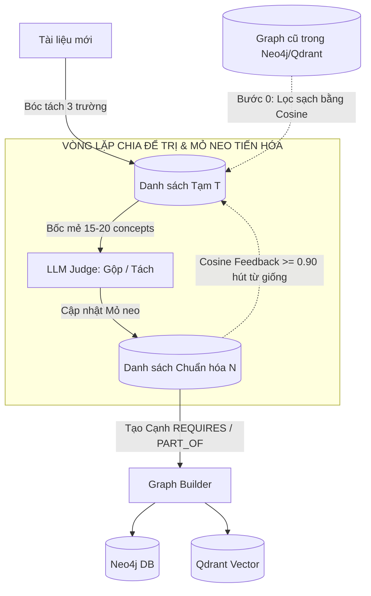

# 🧠 BẢN THIẾT KẾ KIẾN TRÚC TỔNG THỂ TỪ A ĐẾN Z: OMNI-TEACHING ENGINE
**Dự án:** `your-learning`  
**Mục tiêu:** Xây dựng một Gia sư Toàn năng, Tương tác Chủ động (Proactive), Đa phương thức (Omni-modal), Giao tiếp bằng Giọng nói thời gian thực (Full-Duplex Voice) và Cá nhân hóa sâu sắc qua Đồ thị Tri thức Đa ngữ (Multilingual GraphRAG).

---

## PHẦN 1: TỔNG QUAN KIẾN TRÚC HAI GIAI ĐOẠN

Triết lý lõi: **Tách biệt hoàn toàn quá trình Chuẩn bị (Soạn giáo án ngầm - AOT) và Giao tiếp (Lên lớp trực tiếp - JIT)** để đạt tốc độ phản hồi tức thì (<100ms) và tốn 0 đồng chi phí duy trì khi học sinh đang học.

```
[Học liệu: Video + Slide + PDF]
               │
               ▼ (Chạy ngầm / AOT Ingestion)
┌─────────────────────────────────────────────────────────────┐
│ 1. Omni-Parsers: MarkItDown (Text/Slide) + Whisper (Video)  │
│ 2. Extractor: DeepSeek Flash (Schema: en, vn, acronym)      │
│ 3. Thuật toán Mỏ neo tiến hóa (Cách 1) + Qdrant Pre-filter │
│ 4. Neo4j Graph sạch 100% + Qdrant Vector                   │
└─────────────────────────────────────────────────────────────┘
               │
               ▼ (Thời gian thực / JIT Runtime)
┌─────────────────────────────────────────────────────────────┐
│ 1. Event-Driven UI: Canvas + Video Player + Slide Sync      │
│ 2. Teaching Modalities: Slide Presenter, Video Co-pilot TA  │
│ 3. Voice Full-Duplex: Silero VAD (30ms) + Edge-TTS (Local) │
│ 4. Proactive Loop: Idle Timer (20s) + Widget Telemetry      │
│ 5. Não bộ suy luận: Local Qwen 3.5-9B (Ollama)             │
└─────────────────────────────────────────────────────────────┘
```

---

## PHẦN 2: QUY TRÌNH SOẠN GIÁO ÁN & XÂY DỰNG GRAPH (AOT INGESTION)

Khâu này giải quyết triệt để vấn đề: **Trùng lặp, loãng Graph, rào cản Anh - Việt, và xử lý liên bài học (Chương 1 vs Chương 10)**.

### 1. Chuẩn hóa Schema Đa ngữ ngay tại nguồn (3-Field Extraction)
Khi LLM (DeepSeek Flash) đọc từng mẩu tài liệu (Chunk), nó **bắt buộc** phải bóc tách thực thể theo Schema Pydantic 3 trường cố định:

```python
class ConceptExtract(BaseModel):
    name_en: str                  # Tên chuẩn tiếng Anh (Canonical Name)
    name_vn: Optional[str] = None # Thuật ngữ tiếng Việt tương đương
    acronym: Optional[str] = None # Viết tắt chính thức (vd: CNN, SGD, RNN)
    context_snippet: str          # Câu văn chứa thực thể
    source_location: str          # Vị trí: "video:14:20", "slide:12", hoặc "pdf:p4"
```

*Quy tắc chuẩn hóa:*
- **Thuật ngữ STEM / Kỹ thuật / Toán:** Bắt buộc chuẩn hóa `name_en` sang tiếng Anh chuẩn quốc tế (ví dụ: *"Hàm mất mát"* $\to$ `name_en: "Loss Function"`, `name_vn: "Hàm mất mát"`, `acronym: null`).
- **Tên riêng / Lịch sử / Văn hóa Việt Nam:** `name_en` giữ nguyên tiếng Việt chuẩn.
- **Tạo Node:** `name_en` làm Tên chính thức (`canonical_name`), `name_vn` và `acronym` tự động đưa vào danh sách `aliases`.

---

### 2. Thuật toán Xây Graph "Chia Để Trị Bằng Mỏ Neo" (Cách 1)
Thuật toán đảm bảo không bao giờ tràn context, không phụ thuộc thứ tự đọc, và kết nối hoàn hảo với Graph cũ.



#### Bước 0: "Lọc bụi" với Graph cũ (Pre-filtering bằng Qdrant)
Trước khi bắt đầu vòng lặp:
1. Đem toàn bộ các từ trong `Danh sách Tạm (T)` quét Cosine nhanh qua Qdrant (nơi lưu toàn bộ vector của Graph cũ từ các bài học trước).
2. **Nếu Cosine $\ge 0.92$ (Khớp rõ ràng):** Tự động hút thẳng vào Node cũ trong Graph (thêm `name_vn` / `acronym` vào `aliases` của Node cũ, nối vết tài liệu mới). **XÓA KHỎI $T$ NGAY LẬP TỨC (0 đồng token LLM)**.
3. **Nếu Cosine $0.80 - 0.92$ (Nghi vấn):** Kéo Node cũ đó từ Neo4j vào `Danh sách Chuẩn hóa (N)` để làm Mỏ neo ứng viên đối chiếu.

#### Bước 1: Vòng lặp Mỏ neo tiến hóa (Divide-and-Conquer Loop)
Lúc này $T$ chỉ chứa các khái niệm thực sự mới. Chạy vòng lặp cho đến khi $T$ rỗng:
1. **Bốc mẻ (Sampling):** Lấy một mẻ gồm 15–20 khái niệm từ $T$ (ưu tiên khái niệm có tần suất cao).
2. **LLM Chuẩn hóa & Phân loại:**
   - Đưa mẻ này cho LLM cùng các Mỏ neo liên quan trong $N$.
   - LLM phán quyết: Khái niệm nào là đồng nghĩa $\to$ Gộp vào 1 Mỏ neo; Khái niệm nào độc lập $\to$ Tách thành Mỏ neo mới. Nếu gặp thuật ngữ chuẩn hơn $\to$ Nâng cấp `name_en`.
   - Cập nhật các Mỏ neo này vào $N$.
3. **Quét ngược (Cosine Feedback & Hút tự động):**
   - Đem các Mỏ neo trong $N$ tính Cosine ma trận với toàn bộ các từ còn lại trong $T$.
   - Bất kỳ từ nào trong $T$ có `Cosine >= 0.90` với một Mỏ neo trong $N$ $\to$ **Tự động hút vào `aliases` của Mỏ neo đó và xóa khỏi $T$ mà không cần gọi LLM**.
4. **Lặp lại** cho đến khi $T$ hết sạch.

#### Bước 2: Thiết lập Cạnh quan hệ & Dấu vết học liệu
*   **Cạnh Tri thức:** `(Concept_A) -[:REQUIRES]-> (Concept_B)`, `(Concept_A) -[:PART_OF]-> (Concept_C)`.
*   **Cạnh Đa học liệu (Multi-Asset Cross-Linking):**
    - `(Video: "14:20") -[:MENTIONS]-> (Concept_A)`
    - `(Slide: 12) -[:MENTIONS]-> (Concept_A)`
    - `(PDF: "p.4") -[:MENTIONS]-> (Concept_A)`

---

## PHẦN 3: CƠ CHẾ GIẢNG DẠY CHUYÊN BIỆT (TEACHING MODALITIES)

Tùy vào loại tài liệu đang hiển thị trên màn hình, Agent sẽ thay đổi vai trò (Persona), bộ công cụ điều khiển giao diện (UI Tools) và phương pháp sư phạm:

### 1. Dạy qua Video bài giảng (Chế độ: Trợ giảng Co-pilot TA)
*   **Hành vi:** Nhường sân khấu cho Video gốc của Giáo sư thật. Agent ngồi quan sát mốc thời gian (`currentTime`).
*   **Tương tác Kéo (Học sinh hỏi):**
    - Học sinh bấm Pause lúc 12:45: *"Thầy ơi đoạn này là sao?"*
    - Agent lấy Transcript mốc 12:45, tra vào GraphRAG $\to$ Biết học sinh đang hổng kiến thức nền nào từ tuần trước $\to$ Bật mic giải thích cặn kẽ.
*   **Tương tác Đẩy (Agent chủ động):**
    - Đến đoạn giáo sư nói quá nhanh/khó $\to$ Agent chủ động gọi lệnh `pause_video()`, bật mic: *"Đoạn này giáo sư lướt hơi nhanh, để anh tóm tắt lại bằng sơ đồ trên màn hình nhé"* $\to$ Tự bật Widget tóm tắt đè lên video.

### 2. Dạy qua Slide PPTX / PDF (Chế độ: Thuyết trình tăng cường - Augmented Presenter)
*   **Soạn bài tăng cường (Script Expansion):** Slide vốn chỉ có gạch đầu dòng (bullet points). Khâu AOT Ingestion tự động dùng Graph để viết thêm Kịch bản nói (Speaker Notes) chi tiết cho từng trang slide.
*   **Lên lớp & Điều khiển UI:**
    - **Lật trang:** Agent gọi Tool `show_slide(page_number)`.
    - **Vẽ đè lên Slide (Canvas Overlay):** Agent gọi Tool `draw_on_slide(text, x, y, color)` để khoanh đỏ, vẽ mũi tên hoặc viết thêm công thức đè lên lớp kính trong suốt của Slide.
    - **Chèn Slide cứu trợ (Dynamic Insertion):** Nếu bước nhảy kiến thức giữa Slide 2 và 3 quá lớn, Agent tự sinh nóng một "Slide 2.1" (bằng Markdown/HTML) chèn vào giữa để bắc cầu giải thích.
    - **Bật Widget mô phỏng:** Hiển thị công cụ thí nghiệm tương tác ngay cạnh Slide tĩnh.

### 3. Dạy qua Văn bản Text/Docx (Chế độ: Hỏi đáp Socratic)
*   **Hành vi:** Không bắt học sinh đọc một đoạn văn dài. Agent chia nhỏ văn bản, đặt các câu hỏi gợi mở, nhúng các Widget trắc nghiệm (Quiz, Drag & Drop) xen kẽ để học sinh tương tác liên tục.

### 4. Dạy Đa tài liệu Hợp nhất (Multi-Asset Fusion Mode)
*   **Hành vi:** Đóng vai trò Người điều phối học liệu (Asset Navigator).
*   **Tương tác:** Học sinh đang xem Video bị tắc ở khái niệm khó. Agent nhận biết trong Graph khái niệm này có xuất hiện ở Slide 12 và PDF trang 4 $\to$ Tự động gọi Tool chia đôi màn hình: vừa tạm dừng video, vừa kéo Slide 12 và trích đoạn PDF ra đối chiếu trực tiếp.

---

## PHẦN 4: HỆ THỐNG TƯƠNG TÁC THỜI GIAN THỰC & VOICE FULL-DUPLEX

### 1. Luồng Giọng nói Tức thì & Ngắt lời trong 30ms (Full-Duplex Voice)
Hệ thống chạy 100% mã nguồn mở cục bộ không tốn phí API:
```
[Micro học sinh]
       │
       ▼
[Silero VAD (Local CPU - 30ms)] ──► Phát hiện tiếng người ──► LẬP TỨC NGẮT LOA & CẮT LUỒNG STREAM LLM
       │
       ▼
[SenseVoice / Faster-Whisper] ──► Nhận diện Tiếng Việt / Cảm xúc (100ms)
       │
       ▼
[Local Qwen 3.5-9B (Ollama)] ──► Suy luận Socratic ngắn gọn (50-80 tokens/s)
       │
       ▼
[Edge-TTS / Kokoro-82M] ──► Phát âm thanh giọng Việt truyền cảm ngay câu đầu tiên
```

### 2. Cơ chế Chủ động & Theo dõi môi trường (Proactive & Telemetry)
*Nguyên tắc: Hoàn toàn không tốn token LLM khi học sinh đang suy nghĩ.*
*   **Theo dõi Im lặng (Idle Detection):** Đồng hồ JavaScript trên trình duyệt đếm ngược. Nếu học sinh im lặng nhìn màn hình quá 20 giây mà không tương tác $\to$ Trình duyệt phát tín hiệu `PING_IDLE` $\to$ Gia sư kích hoạt micro: *"Em đang phân vân ở công thức này à, có cần anh gợi ý một chút không?"*
*   **Theo dõi Thao tác Widget (Telemetry):** Khi học sinh kéo thanh trượt trên Canvas $\to$ Giao diện âm thầm gửi sự kiện `WIDGET_CHANGE: slider_val=15` $\to$ Gia sư lập tức cất giọng nhận xét trực tiếp về hành động đó: *"Đúng rồi, em vừa tăng góc lên 15 độ, nhìn parabol kìa!"*
*   **Nhắc nhở Ôn tập (Telegram Background Cron):** Tiến trình nền nhẹ kiểm tra thuật toán Lặp lại ngắt quãng (Spaced Repetition) trên Neo4j. Đến lịch ôn bài $\to$ Tự động sinh câu đố ngắn gửi qua Telegram Bot.

---

## PHẦN 5: CHIẾN LƯỢC CÔNG NGHỆ & MÔ HÌNH (HYBRID STACK)

| Thành phần | Công nghệ Đề xuất | Chi phí & Tài nguyên |
| :--- | :--- | :--- |
| **Soạn bài (AOT Ingestion & Graph Building)** | **DeepSeek V3 / V4 Flash API** | Siêu rẻ (~$0.14/1M tokens, ~3.000đ cho cả cuốn sách). Xử lý nền song song. |
| **Bộ chuyển đổi Đa học liệu** | **MarkItDown** (PDF, Slide, Docx) + **Faster-Whisper** (Video) | Miễn phí 100%, chạy CPU/GPU cục bộ. |
| **Lưu trữ Tri thức & Vector** | **Neo4j** (Đồ thị) + **Qdrant** (Vector Search) | Chạy container cục bộ (Docker) hoặc cloud miễn phí. |
| **Não bộ Gia sư Lên lớp (JIT Runtime)** | **Qwen 2.5 / 3.5 - 7B/9B** qua **Ollama / vLLM** | **0 đồng**, hoàn toàn offline, bảo mật tuyệt đối, tốc độ 50-80 tokens/s. |
| **Giọng nói & Ngắt lời** | **Silero VAD** (Ngắt lời) + **Edge-TTS / Kokoro** (Phát âm) | **0 đồng**, miễn phí, nhận diện ngắt lời trong 30ms. |

---

## PHẦN 6: LỘ TRÌNH THỰC THI (ACTIONABLE ROADMAP)

*   **Sprint 1: Schema Đa ngữ & Thuật toán Xây Graph (Cách 1)**
    *   Tích hợp `markitdown` vào tầng Ingestion.
    *   Viết Prompt trích xuất chuẩn 3 trường: `name_en`, `name_vn`, `acronym`.
    *   Cài đặt thuật toán Vòng lặp Mỏ neo tiến hóa (Cách 1) kết hợp lọc Qdrant bước 0.
*   **Sprint 2: Cơ chế Thuyết trình Slide Tăng cường (Augmented Presenter)**
    *   Xây dựng Canvas Viewer cho Slide.
    *   Cấp Tool cho Agent: `show_slide`, `draw_on_slide`, `insert_dynamic_slide`.
*   **Sprint 3: Media Pipeline & Trợ giảng Video Co-pilot**
    *   Tích hợp `faster-whisper` bóc tách phụ đề có timestamp.
    *   Cơ chế đồng bộ `currentTime` từ Video Player về cho Agent và liên kết chéo với Slide/PDF.
*   **Sprint 4: Cơ chế Chủ động (Proactive & Telemetry)**
    *   Viết Timer đếm Idle trên Frontend.
    *   Xử lý sự kiện `WIDGET_CHANGE` kích hoạt lời thoại của Gia sư.
*   **Sprint 5: Tuyệt đỉnh Giọng nói Full-Duplex (MUSE AI Style)**
    *   Tích hợp `Silero VAD` bắt ngắt lời trong 30ms.
    *   Tích hợp `Edge-TTS` stream âm thanh thời gian thực.
    *   Đấu nối toàn bộ luồng vào `RuntimeEngine` của `your-learning`.
